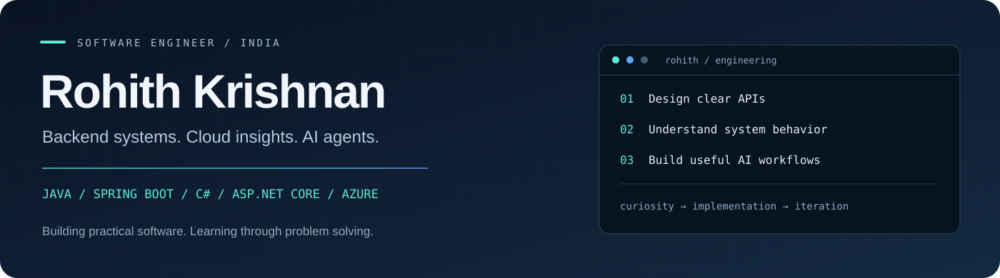

  

  <strong>Software Engineer at Accenture</strong> 
  Java &amp; Spring Boot · C# &amp; ASP.NET Core · Azure · AI Agents

  <a href="https://www.linkedin.com/in/s-rohith-krishnan/"><strong>LinkedIn ↗</strong></a>
  &nbsp; · &nbsp;
  <a href="https://github.com/Krish-rk?tab=repositories"><strong>Explore my repositories ↗</strong></a>

---

### A little about me

I'm Rohith, a software engineer based in India. I work on backend APIs, cloud monitoring and AI-assisted workflows, and enjoy connecting application development with an understanding of how systems behave.

At Accenture, my work includes AI agents and monitoring workflows using **Copilot Studio, Azure Application Insights and KQL**. My personal projects explore **Java, Spring Boot, relational data modeling, authentication and full-stack applications**.

I practice **data structures and algorithms in C++** because I enjoy breaking down difficult problems, comparing approaches and understanding their tradeoffs.

### Selected work

<table>
  <tr>
    <td width="50%" valign="top">
      <h3>🌾 FarmXChain</h3>
      
A full-stack agricultural traceability project with role-based dashboards, product and order workflows, image uploads and Gemini-assisted quality analysis.

      
<strong>Java 21 · Spring Boot · React · MySQL · Gemini</strong>

      
<a href="https://github.com/Krish-rk/Java-FarmxChain"><strong>Explore project →</strong></a> &nbsp; <a href="https://github.com/Krish-rk/Java-FarmxChain#screenshots">Screenshots</a>

    </td>
    <td width="50%" valign="top">
      <h3>🛒 E-Commerce Backend</h3>
      
A Spring Boot API covering product catalogs, shopping carts, addresses and orders, with JWT cookie authentication and a layered service architecture.

      
<strong>Java 17 · Spring Security · JPA · MySQL</strong>

      
<a href="https://github.com/Krish-rk/EcommerceApp"><strong>Explore project →</strong></a> &nbsp; <a href="https://github.com/Krish-rk/EcommerceApp/tree/main/src/main/java/com/ecommerce/project/controller">API controllers</a>

    </td>
  </tr>
  <tr>
    <td width="50%" valign="top">
      <h3>💼 Recruitment Management API</h3>
      
A backend for employers, candidates, job advertisements and application status workflows, organized around service contracts, validated requests and DTOs.

      
<strong>Java 17 · Spring Boot · PostgreSQL · JPA</strong>

      
<a href="https://github.com/Krish-rk/HR-Management-System"><strong>Explore project →</strong></a> &nbsp; <a href="https://github.com/Krish-rk/HR-Management-System/tree/main/src/test/java/hrms/hrms">Test source</a>

    </td>
    <td width="50%" valign="top">
      <h3>🧪 AI Testing Application · In progress</h3>
      
Exploring the foundation for an AI testing tool. The current repository contains a Next.js scaffold with authentication, database integration and Stripe endpoints; AI test generation is planned.

      
<strong>Next.js · TypeScript · Clerk · Drizzle · Stripe</strong>

      
<a href="https://github.com/Krish-rk/ai-testing-automation-agent"><strong>View current progress →</strong></a>

    </td>
  </tr>
</table>

### My engineering toolkit

| Area | Technologies & concepts |
| :--- | :--- |
| **Backend development** | Java, Spring Boot, C#, ASP.NET Core, REST APIs |
| **Data & persistence** | SQL, MySQL, PostgreSQL, Spring Data JPA, Entity Framework Core |
| **Cloud & observability** | Azure, Application Insights, KQL, telemetry and incident monitoring |
| **AI workflows** | Copilot Studio, AI agents, Gemini API integration |
| **Frontend** | React, JavaScript, HTML, CSS, Tailwind CSS |
| **Foundations** | C++, data structures & algorithms, OOP, SOLID, Git |

### How I approach engineering

- **Understand the problem:** Define the workflow and constraints before choosing an implementation.
- **Keep responsibilities clear:** Separate API contracts, business rules and persistence.
- **Look beyond the happy path:** Think about validation, failures and operational visibility.
- **Learn by building:** Turn concepts into working projects and refine them as I learn.

### What I'm working toward

Deepening my Java backend and system design skills, expanding meaningful test coverage, and building AI workflows that solve practical engineering problems.

---

  <strong>Let's connect.</strong> 
  Happy to discuss backend engineering, problem solving and practical AI applications.  
  <a href="https://www.linkedin.com/in/s-rohith-krishnan/">Find me on LinkedIn →</a>

